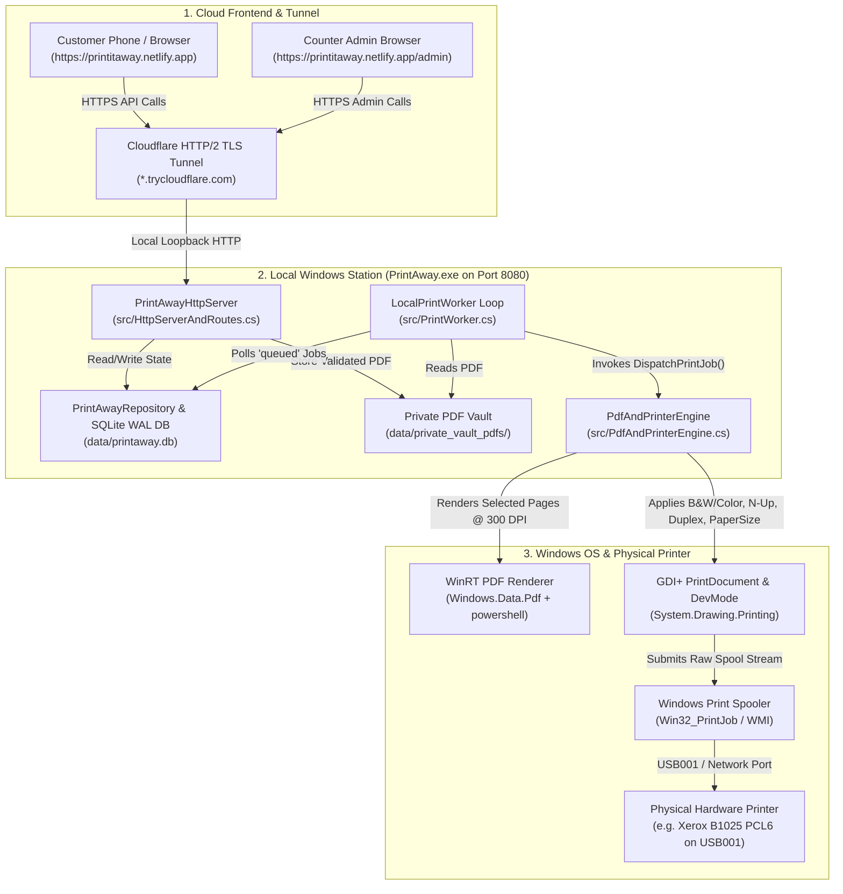

# PrintAway — Complete System Architecture, Printer Command Flow & 1-Click Migration Guide

This guide explains:
1. **The End-to-End Order & Printing Flow** (from a customer's phone on Netlify all the way to physical paper coming out of the USB printer).
2. **How We Command the Hardware Printer Under the Hood** (WinRT PDF rendering, GDI+ `PrintDocument`, Color/B&W matrices, N-Up tiling, Duplex, and Windows Spooler Job ID verification).
3. **Clean Project Organization** (what every folder and file does).
4. **How to Change Your Printer or Move to a New Computer in One Go**.

---

## 1. End-to-End System Flow



### Step-by-Step Lifecycle of Every Print Order

1. **Shop Status & Capabilities Discovery (`GET /api/shop/status`)**
   - When the customer opens `http://127.0.0.1:8080/` or `https://printitaway.netlify.app/`, the UI fetches `/api/shop/status`.
   - The server checks `stations`, `printers`, `printer_queues`, and `price_rules` in SQLite (`data/printaway.db`) and returns the active printer model, whether Color / Duplex / Page Range are enabled, allowed paper sizes (`A4,Legal,Letter`), and per-side pricing.

2. **PDF Upload & Security Validation (`POST /api/uploads`)**
   - The browser sends the raw PDF bytes to the station.
   - `PdfAndPrinterEngine.ValidatePdf()` inspects the file:
     - Verifies the `%PDF-` magic header and `%%EOF` trailer.
     - Rejects password-protected (`/Encrypt`) or malicious embedded JavaScript (`/JS`, `/JavaScript`) files.
     - Counts the exact number of pages and computes a cryptographic `SHA-256` hash.
   - The clean PDF is saved inside `data/private_vault_pdfs/YYYYMMDD/file_<random_token>.pdf` (never using the user's raw filename on disk).

3. **Server-Authoritative Quote Calculation (`POST /api/orders/quote`)**
   - The customer selects their print settings:
     - **Color Mode:** `bw` (Black & White) or `color` (Full Color)
     - **Page Selection:** `all`, `first:N`, `odd`, `even`, or custom ranges/chips like `1-3,5`
     - **Sides:** `OneSided` (Simplex) or `DuplexLongEdge` / `DuplexShortEdge`
     - **Layout:** `1`, `2`, or `4` Pages per Sheet (N-Up), `PaperSize` (`A4`, `Legal`, `Letter`), `Orientation` (`auto`, `portrait`, `landscape`), `Copies`, and `Collate`.
   - `PdfAndPrinterEngine.CalculateQuote()` resolves the exact list of page numbers, divides by `pagesPerSheet` for N-Up, calculates physical sheets and printed sides, applies the active `price_rules` version, and locks an immutable quote in the `quotes` table.

4. **Order Creation & Verified Payment (`POST /api/orders` & `/api/payments/webhook`)**
   - Creating the order generates a non-guessable tracking token (`pub_...`), a 6-character **Pickup Code**, and a payment intent.
   - Once the HMAC-SHA256 signed payment webhook confirms payment, the order moves to `paid_awaiting_approval`.
   - **Safety Gate:** Paid orders **never** print blindly without counter approval (`paid_awaiting_approval`).

5. **Counter Staff Review, Override & Approval (`/admin`)**
   - Staff logs into `/admin` (`admin` / `PrintAway@Admin2026`).
   - Staff can optionally click **⚙ Edit Settings** on any order to override B&W/Color, page ranges, copies, duplex, or N-Up before printing.
   - Clicking **✓ Approve & Print** atomically transitions the order from `paid_awaiting_approval` &rarr; `queued`, creates the `print_jobs` record, and wakes up `LocalPrintWorker` immediately.

---

## 2. How We Command the Physical Printer at the End

Once an order enters `queued`, `LocalPrintWorker.RunSingleCycle()` ([src/PrintWorker.cs](file:///c:/Users/Vikash/Documents/PrintAway/src/PrintWorker.cs)) claims a lease on the job and calls `PdfAndPrinterEngine.DispatchPrintJob()` ([src/PdfAndPrinterEngine.cs](file:///c:/Users/Vikash/Documents/PrintAway/src/PdfAndPrinterEngine.cs)):

### Stage A: Pre-Flight Hardware & WMI Spooler Health Check
- Queries Windows WMI (`SELECT * FROM Win32_Printer`) via `System.Management`.
- Verifies that the target Windows queue (e.g. `Xerox B1025 Multifunction Printer PCL6`) is installed, not `WorkOffline`, and not in a Paper Jam or Out-of-Paper state.

### Stage B: High-Resolution Native WinRT PDF Page Rendering
- Invokes `scripts/render-pdf.ps1`, which uses the built-in Windows 10/11 Runtime API `Windows.Data.Pdf.PdfDocument`.
- Renders **only** the exact pages requested by the customer (e.g. pages `1, 3, 5`) into high-resolution PNG bitmaps at 300 DPI inside a temporary job folder.

### Stage C: GDI+ Hardware Print Stream Construction (`System.Drawing.Printing.PrintDocument`)
- Creates a native Windows `PrintDocument` bound to `PrinterSettings.PrinterName = targetQueueName`.
- **Copies & Collation:** Sets `PrinterSettings.Copies` and `PrinterSettings.Collate`.
- **Duplex Control:** Sets `PrinterSettings.Duplex` to `Duplex.Simplex`, `Duplex.Vertical` (Long-Edge), or `Duplex.Horizontal` (Short-Edge).
- **Paper Size:** Matches `PaperSizes` on the driver (`A4`, `Legal`, `Letter`) and assigns `DefaultPageSettings.PaperSize`.
- **Orientation:** Auto-detects from page dimensions or forces Portrait / Landscape.
- **Color vs. Black & White Enforcement:**
  - Sets `DefaultPageSettings.Color = (colorMode == "color")`.
  - For `bw` jobs, applies an explicit **ITU-R BT.601 luminance grayscale `ColorMatrix`** (`0.299R + 0.587G + 0.114B`) via `ImageAttributes` during `Graphics.DrawImage()` so even color drivers strictly receive pure monochrome raster data.
- **N-Up Multi-Page Tiling (1-Up, 2-Up, 4-Up):**
  - Inside the `PrintPage` event handler, computes a 1-cell, 2-cell, or 2x2 grid inside the printable area and draws up to `pagesPerSheet` PDF pages onto each physical side while preserving aspect ratio.

### Stage D: Windows Spooler Job ID Capture & Post-Spool Reconciliation
- Calls `printDoc.Print()`, which streams the GDI+/PCL6 print job into the Windows Print Spooler (`spoolsv.exe`).
- Queries `Win32_PrintJob` to capture the real Windows Spooler Job ID and records `submitted_to_spooler` in SQLite.
- Temporary rendered page bitmaps are immediately wiped from disk.

---

## 3. Clean Project Structure

```text
PrintAway/
├── config/
│   └── station.json                 # Portable config: active printer queue, port, shop name, Netlify URL
├── src/                             # C# Source Code (compiles via built-in Windows .NET 4.8 csc.exe)
│   ├── Program.cs                   # Entrypoint, CLI args, config/station.json loader, printer auto-detect
│   ├── HttpServerAndRoutes.cs       # HTTP Server, REST API endpoints, CORS, auth & static file serving
│   ├── DatabaseSchemaAndRepo.cs     # SQLite schema, migrations, quotes, orders, admin controls
│   ├── PdfAndPrinterEngine.cs       # PDF validator, quote math, WMI printer discovery & GDI+ print engine
│   ├── PrintWorker.cs               # Background print worker polling & lease state machine
│   ├── SqliteInterop.cs             # P/Invoke wrapper for built-in Windows C:\Windows\System32\winsqlite3.dll
│   └── SelfTestSuite.cs             # 10-test automated verification suite (PRD §14)
├── web/                             # Static Frontend (served locally AND deployed to Netlify)
│   ├── index.html                   # Customer QR Storefront (upload, page picker, B&W/Color, live quote, UPI)
│   ├── admin.html                   # Counter Staff Admin Dashboard (approve, override, printer & price controls)
│   └── _redirects                   # Netlify URL rewrite rules
├── scripts/                         # Automation & Operations Scripts
│   ├── setup-station.ps1            # Interactive wizard for new PC / new printer setup
│   ├── start-tunnel.ps1             # Starts PrintAway.exe + Cloudflare HTTP/2 tunnel + auto-syncs Netlify
│   ├── build-and-test.ps1           # Compiles src/*.cs -> bin/PrintAway.exe and runs 10 self-tests
│   ├── render-pdf.ps1               # Native WinRT Windows.Data.Pdf rasterizer helper
│   ├── diagnose-host.ps1            # Hardware printer & spooler diagnostic inspector
│   └── test-print-proof.ps1         # End-to-end physical test print verifier
├── docs/                            # Documentation
│   ├── SYSTEM_FLOW_AND_MIGRATION_GUIDE.md
│   ├── DECISIONS.md
│   └── PRINTER_DIAGNOSTICS.md
├── bin/                             # Compiled PrintAway.exe and cloudflared.exe (auto-managed)
├── data/                            # Runtime SQLite DB (printaway.db) & Private PDF Vault (git-ignored)
├── setup-new-pc.bat                 # 1-Click Wizard to set up a new computer or switch printers
├── start-station.bat                # 1-Click Daily Launcher (Server + Cloudflare Tunnel + Netlify Auto-Sync)
└── netlify.toml                     # Netlify build & routing configuration
```

---

## 4. How to Change Your Printer Tomorrow (3 Easy Ways)

If you buy a new printer tomorrow (HP, Canon, Epson, Brother, Xerox, Ricoh — USB or Wi-Fi/LAN):

### Method 1: Live from the Admin Browser Dashboard (Zero Restart)
1. Plug in the new printer so Windows installs its driver.
2. Open `/admin` (`http://127.0.0.1:8080/admin` or `https://printitaway.netlify.app/admin`).
3. In the **Printer & Queue Controls** panel on the right, open the **Active Windows Queue** dropdown.
4. Select your new printer and click **Save Printer Capabilities**.
5. Done! All future print jobs immediately route to the new printer, and the customer storefront banner updates automatically.

### Method 2: Double-Click `setup-new-pc.bat`
1. Double-click [`setup-new-pc.bat`](file:///c:/Users/Vikash/Documents/PrintAway/setup-new-pc.bat) in the project folder.
2. It lists all printers installed on Windows (`[1]`, `[2]`, etc.), marking `[PHYSICAL HARDWARE]` vs `[VIRTUAL]`.
3. Type the number of your new printer and press Enter. It updates [`config/station.json`](file:///c:/Users/Vikash/Documents/PrintAway/config/station.json) and launches the station.

### Method 3: Edit `config/station.json` (or set `"auto"`)
Open [`config/station.json`](file:///c:/Users/Vikash/Documents/PrintAway/config/station.json):
```json
{
  "activePrinterQueue": "auto",
  "autoFallbackToPhysicalPrinter": true
}
```
When set to `"auto"` (or when `autoFallbackToPhysicalPrinter` is `true`), `PrintAway.exe` automatically scans Windows on startup, ignores virtual drivers (`Print to PDF`, `OneNote`, `XPS`, `Fax`), and locks onto your connected physical hardware printer automatically!

---

## 5. How to Move to a Brand-New Computer Tomorrow ("Setup in a Go")

PrintAway is engineered with **zero external runtime installers** — it compiles and runs using components built into every Windows 10 and Windows 11 PC out of the box (`csc.exe`, `winsqlite3.dll`, and `Windows.Data.Pdf`).

### Step-by-Step on a New Windows 10 / 11 PC:

1. **Connect Your Printer** to the new PC via USB or Wi-Fi so it appears in Windows *Printers & Scanners*.
2. **Copy or Clone the Folder:**
   ```powershell
   git clone https://github.com/Shivamborn2shine/PrintPilot.git
   cd PrintPilot
   ```
   *(Or simply copy the `PrintAway` folder via USB drive).*
3. **Double-Click `setup-new-pc.bat`:**
   - Verifies Windows native compiler & SQLite.
   - Compiles `bin\PrintAway.exe` and runs all 10 self-tests.
   - Detects your connected printer and saves `config\station.json`.
4. **Double-Click `start-station.bat` (Daily Startup):**
   - Starts `PrintAway.exe` on `http://127.0.0.1:8080`.
   - Automatically downloads `bin\cloudflared.exe` if missing.
   - Starts the secure HTTP/2 tunnel (`https://*.trycloudflare.com`).
   - Automatically updates `web/index.html` and `web/admin.html` with the new tunnel URL and pushes to GitHub so `https://printitaway.netlify.app` connects to your new PC automatically!
